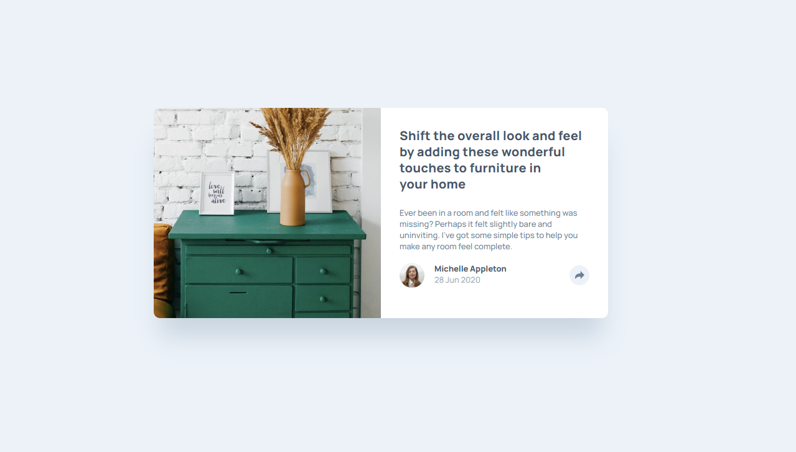

# Frontend Mentor - Article Preview Component

A solution to the [Article Preview Component](https://www.frontendmentor.io/challenges/article-preview-component-dYBN_pYFT) challenge on Frontend Mentor. Built with plain HTML, CSS, and JavaScript — no frameworks.

**Live Site:** https://hshs-dev.github.io/article-preview-component/

**Repository:** https://github.com/HsHs-dev/article-preview-component

## Built with

- Semantic HTML5
- CSS custom properties
- Flexbox for component alignment and the mobile layout
- CSS Grid for the desktop layout
- CSS media queries for responsive design
- Native CSS nesting
- CSS transitions for the share panel
- JavaScript DOM manipulation and event listeners
- Mobile-first workflow
- Manrope from Google Fonts

## Reflections

### What I learned

- **Combining Flexbox and Grid:** Flexbox works well for arranging elements along a single axis, while Grid makes it easier to reorganize the component into a two-column layout on larger screens.
- **Creating a CSS tooltip:** A triangle can be constructed using borders with transparent colors. This was useful for creating the small pointer beneath the desktop share panel without adding another HTML element.
- **Managing UI state with JavaScript:** Using `classList.toggle()` makes it straightforward to switch between the visible and hidden states of the share panel by adding or removing CSS classes.
- **CSS transitions:** Combining `opacity` and `visibility` allows the share panel to fade in and out while controlling whether it is visible to users.
- **Responsive component behavior:** The same share panel can behave differently across screen sizes. On mobile, it replaces the author information within the card's bottom section; on desktop, it appears as a floating tooltip.
- **CSS custom properties:** Defining the color palette, typography, and other shared values in `:root` keeps the stylesheet consistent and easier to maintain.

### Challenges

The main challenge was implementing the share interaction while adapting its appearance to different screen sizes.

On mobile, activating the share button changes the background of the author's section, hides the author information, and reveals the social media links. On desktop, the author information remains visible while the share options appear in a floating panel with a triangular pointer.

Handling these different states with shared HTML, CSS classes, and a small JavaScript function helped me understand how responsive styling and DOM manipulation can work together without duplicating components.

Another useful exercise was positioning the share panel relative to its containing element and creating its triangular pointer with CSS borders.

## Useful resources

- [Josh Comeau's CSS Reset](https://www.joshwcomeau.com/css/custom-css-reset/) - Used as the foundation for the project's CSS reset.
- [MDN: CSS Grid Layout](https://developer.mozilla.org/en-US/docs/Web/CSS/CSS_grid_layout) - Useful for understanding and implementing the responsive desktop layout.
- [MDN: Element.classList](https://developer.mozilla.org/en-US/docs/Web/API/Element/classList) - Helped inform the approach to toggling the share panel's visual state.
- [MDN: CSS Transitions](https://developer.mozilla.org/en-US/docs/Web/CSS/CSS_transitions) - Reference for animating changes in the share panel's visibility and opacity.

## AI Collaboration

I used AI as a study partner to discuss CSS behavior, debug layout details, and improve my understanding of positioning, pseudo-elements, and responsive component states. The goal was to understand the reasoning behind the implementation rather than simply generate code.

## Author

- GitHub - [@HsHs-dev](https://github.com/HsHs-dev)
- Frontend Mentor - [@HsHs-dev](https://www.frontendmentor.io/profile/HsHs-dev)
