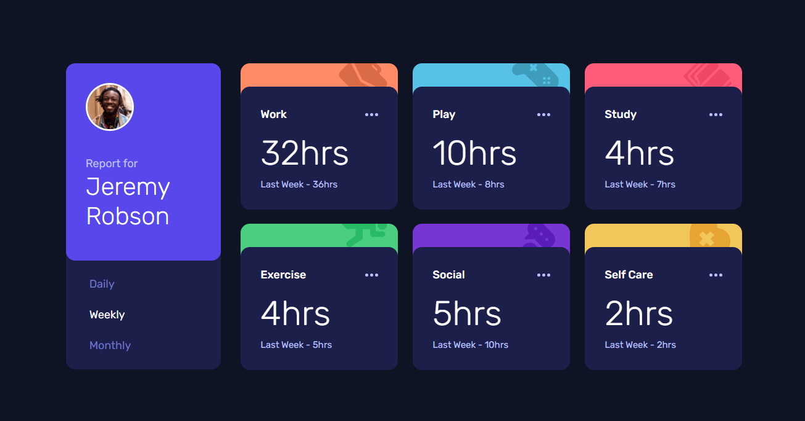

# Frontend Mentor - Time Tracking Dashboard

A solution to the [Time Tracking Dashboard](https://www.frontendmentor.io/challenges/time-tracking-dashboard-UIQ7167Jw) challenge on Frontend Mentor. Built with plain HTML, CSS, and JavaScript — no frameworks.

**Live Site:** https://hshs-dev.github.io/time-tracking-dashboard/

**Repository:** https://github.com/HsHs-dev/time-tracking-dashboard

## Design Preview

## Built with

- Semantic HTML5
- CSS custom properties
- Flexbox for mobile layouts and component alignment
- CSS Grid for tablet and desktop activity layouts
- CSS media queries for responsive design
- Native CSS nesting
- JavaScript DOM manipulation and event listeners
- Fetch API for loading local JSON data
- Dynamic HTML generation using template literals
- Mobile-first workflow
- Rubik from Google Fonts

## Reflections

### What I learned

- **Data-driven UI rendering:** Instead of hardcoding six activity cards in HTML, I used JavaScript to generate them dynamically from a JSON dataset. This helped me understand how to separate content from presentation.

- **Working with the Fetch API:** Loading `data.json` asynchronously using `fetch()` gave me practical experience working with external data and handling the response as JSON.

- **Managing UI state:** Keeping track of the currently selected timeframe using a JavaScript variable made it easier to update the dashboard without unnecessarily rebuilding the entire interface.

- **DOM manipulation:** Using `querySelector()`, `classList`, `setAttribute()`, and `textContent` helped me connect user interactions with changes in the interface.

- **Accessible interactive states:** Using `aria-pressed` on the timeframe buttons communicates which filter is currently selected, keeping the accessibility state synchronized with the visual state.

- **CSS Grid and Flexbox:** I used Flexbox to stack the activity cards on mobile, then introduced a three-column CSS Grid layout for tablet and desktop. At larger screen sizes, the report panel moves alongside the activity grid.

- **CSS custom properties and nesting:** Organizing the color palette, typography, and component styles through custom properties and native CSS nesting made the stylesheet easier to maintain.

### Challenges

The main challenge was building the dashboard dynamically rather than relying on predefined HTML cards.

I approached this by separating the process into two functions: one responsible for generating the activity cards from the JSON data, and another responsible for updating their displayed statistics based on the selected timeframe.

This separation made the implementation easier to reason about. The structure of the dashboard is generated once, while switching between Daily, Weekly, and Monthly only updates the relevant text and values.

Another interesting challenge was organizing the responsive layout. The dashboard uses different arrangements across breakpoints, transitioning from a vertically stacked mobile layout to a multi-column activity grid and eventually a horizontal desktop dashboard.

## Useful resources

- [MDN: Fetch API](https://developer.mozilla.org/en-US/docs/Web/API/Fetch_API) - A reference for understanding asynchronous data fetching in JavaScript.
- [MDN: Array.map()](https://developer.mozilla.org/en-US/docs/Web/JavaScript/Reference/Global_Objects/Array/map) - Useful for transforming the JSON activity data into HTML components.
- [MDN: CSS Grid Layout](https://developer.mozilla.org/en-US/docs/Web/CSS/CSS_grid_layout) - Helped with building and organizing the responsive dashboard layout.
- [MDN: aria-pressed](https://developer.mozilla.org/en-US/docs/Web/Accessibility/ARIA/Reference/Attributes/aria-pressed) - Reference for communicating the selected state of toggle buttons.
- [Josh Comeau's CSS Reset](https://www.joshwcomeau.com/css/custom-css-reset/) - Used as the foundation for the project's CSS reset.

## AI Collaboration

I used AI as a study partner to discuss JavaScript implementation choices, reason about DOM manipulation and state management, and improve my understanding of responsive layouts. The focus was on understanding the underlying concepts and making deliberate implementation decisions rather than simply generating code.

## Author

- GitHub - [@HsHs-dev](https://github.com/HsHs-dev)
- Frontend Mentor - [@HsHs-dev](https://www.frontendmentor.io/profile/HsHs-dev)
